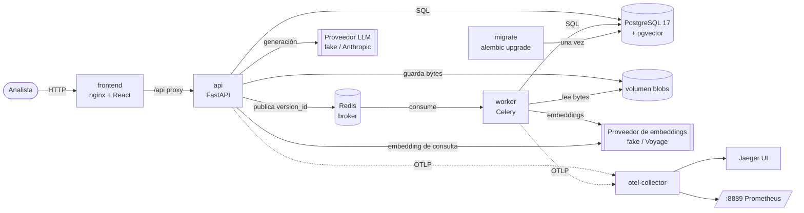
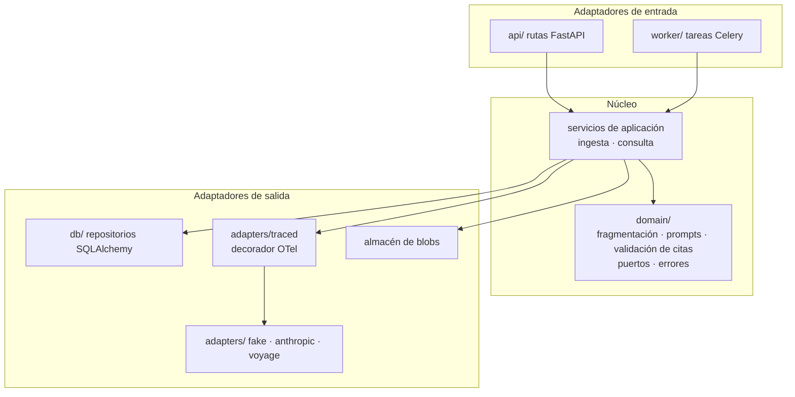
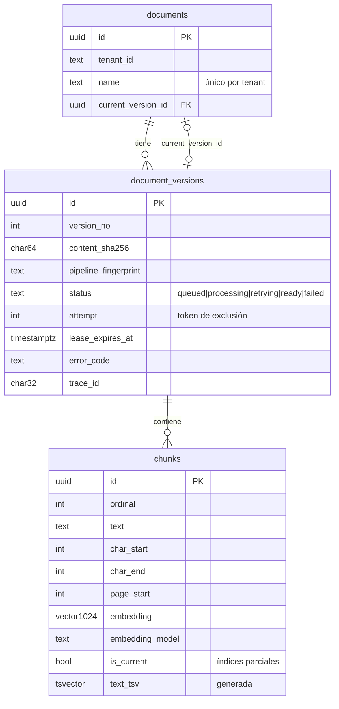
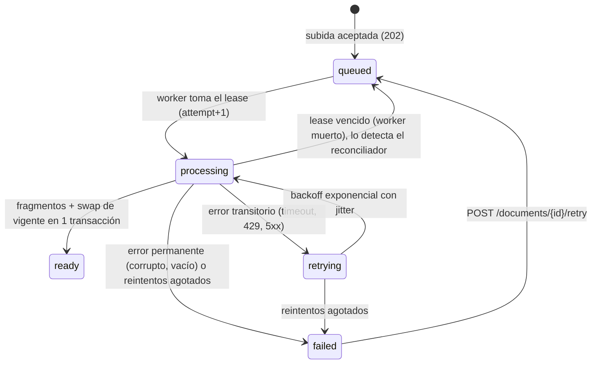
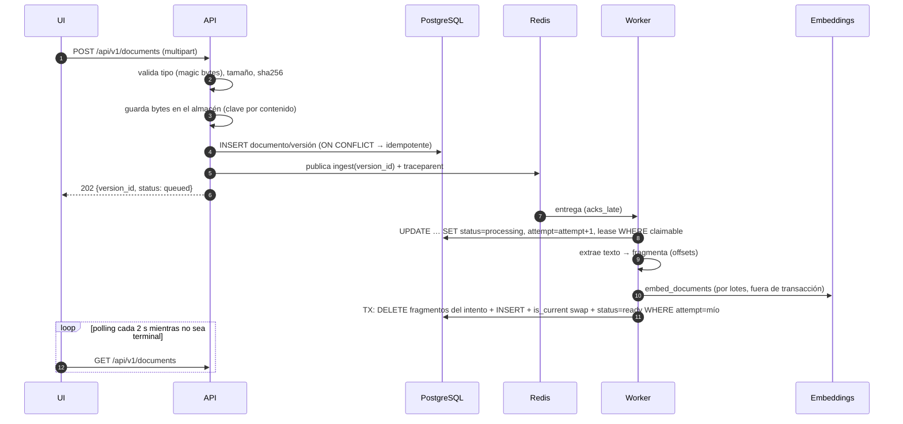
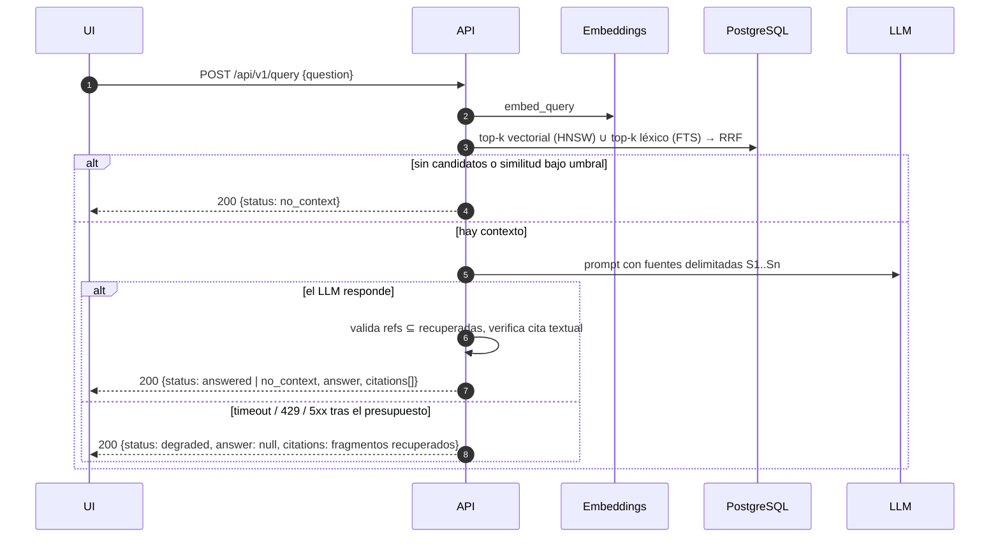

# Arquitectura

Este documento describe **cómo** está construido el sistema. El **porqué** de cada decisión está en `DECISIONS.md`.

## Vista de contenedores

`api`, `worker` y `migrate` comparten imagen y código: es un monolito modular desplegado como varios procesos.

## Capas del backend

Las dependencias apuntan hacia el núcleo. `domain/` no importa FastAPI, Celery, SQLAlchemy ni ningún SDK.

## Modelo de datos

- Clave de idempotencia de una versión: `(document_id, content_sha256, pipeline_fingerprint)`. Subir el mismo
  contenido devuelve la versión existente. Si cambia el pipeline (fragmentador o modelo de embeddings), se crea una
  versión nueva.
- Índices `HNSW (vector_cosine_ops, m=16, ef_construction=128)` y `GIN(text_tsv)`, ambos `WHERE is_current`.

## Máquina de estados de una versión

El documento nunca se pierde: los bytes y la fila sobreviven a cualquier fallo, y `failed` muestra `error_code` en la UI.

## Flujo de ingesta

## Flujo de consulta

## Trazabilidad

Una petición produce **una sola traza**: `HTTP POST` → `apply_async/ingest` → `run/ingest` → `embeddings.*` y
`SQL`. En la consulta: `HTTP POST` → `retrieval.*` → `llm.generate_answer`. Celery transporta el contexto W3C en las
cabeceras del mensaje. El `trace_id` es también el `correlation_id` de los logs, se devuelve en la cabecera
`X-Correlation-ID` y se guarda en `document_versions.trace_id`. Con ese único identificador se encuentran los logs y
la traza de cualquier documento.

Métricas (OTLP → colector → Prometheus en `:8889`):

| Métrica | Tipo | Para qué |
|---|---|---|
| `ingestion.duration` | histograma, por `status` | capacidad del worker, regresiones del pipeline |
| `retrieval.duration` | histograma, por `mode` | latencia de búsqueda, efecto de `ef_search` |
| `llm.request.duration` | histograma, por modelo | latencia del proveedor |
| `llm.request.errors` | contador, por `error.type` | salud del proveedor, tasa de 429 |
| `rag.answers` | contador, por `status` | tasa de abstención y degradación |
